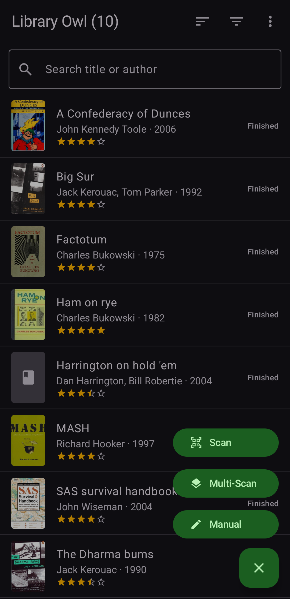
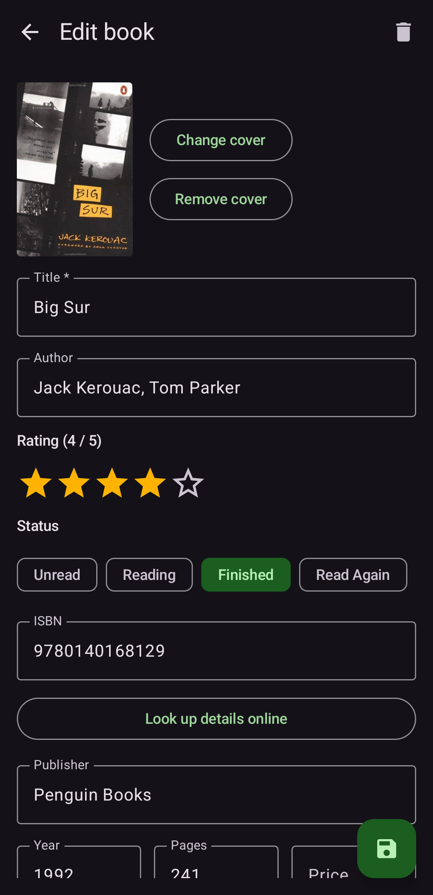
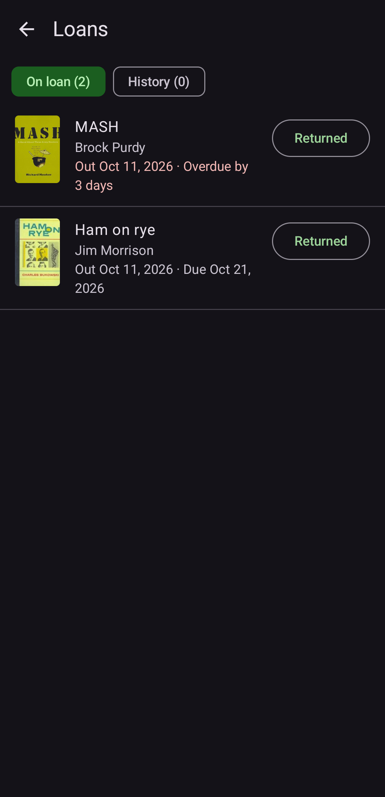
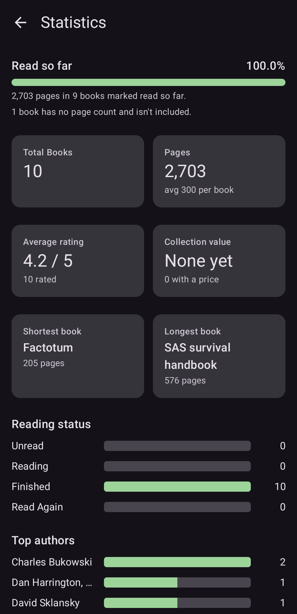
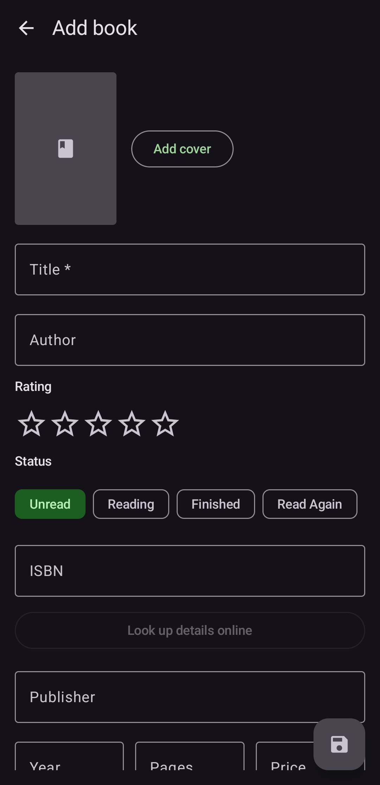

# Library Owl

Library Owl is an Android app for cataloguing your personal book collection.

Package name: `org.thebottle.libOwl`

## Features

- **Add books** by scanning an ISBN barcode or manually
- **Online lookup** of title, author, publisher, year, pages, genre, description and cover (Open Library and Google Books)
- **Search, sort, and filter** by title, author, status, rating, genre, cover, loan status
- **Loan Manager**: record who has a book and when it is due, loan history, and optional daily due-date reminders
- **Statistics**: pages read, collection value, ratings, top authors/genres, and more
- **Reports**: print or save as PDF, as a table or a detailed list, with the properties you choose
- **Backup and restore** of your library, covers, loans and settings to a folder you choose

Your library is stored only on your device. The app uses the network only for book lookups.

## Screenshots

<table>
  <tr>
    <td align="center"> Book list</td>
    <td align="center"> Add menu</td>
    <td align="center"> Book view</td>
  </tr>
  <tr>
    <td align="center"> Loans</td>
    <td align="center"> Statistics</td>
    <td align="center"> Manual entry</td>
  </tr>
</table>

## Installing a release

Download the APK for your phone's processor from the Releases page. Most modern phones need the `arm64-v8a` file.

## Building

1. Open the project in Android Studio (Koala or newer) and let Gradle sync.
2. Run it on a device or emulator, or use **Build > Build APK(s)**.

Requirements: JDK 17, Android SDK 35, minimum Android version 8.0 (API 26).

Barcode scanning uses Google's ML Kit barcode scanner, bundled in the app, so it works without Google Play services.

## License

Copyright is held by the author. Licensed under the Apache License, Version 2.0.
See the [LICENSE](LICENSE) file for details.
